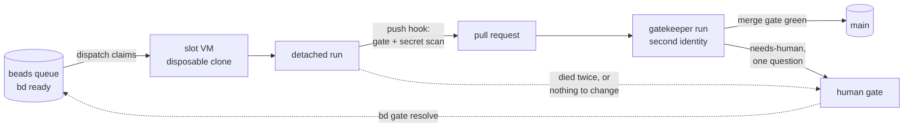

# kiln

Kiln runs Claude Code agents in sandboxed virtual machines and turns their work into reviewed, merged pull requests. You file a task, walk away, and read the pull request history later.

## How a task travels



1. **You file a task** in a [beads](https://github.com/gastownhall/beads) queue. Kiln only launches what `bd ready` lists, so filing a task is what authorizes a run.
2. **A slot takes it.** A slot is a Colima VM holding a disposable clone of your repository. It sees the host through one read-only mount, gets credentials only as per-run environment, and must pass a boundary check before it's given any work.
3. **A run does the work** on a branch, reviews its own diff, passes your project's gate, and opens a pull request.
4. **A gatekeeper lands it.** A second run, under a separate GitHub identity, merges main into the branch, runs your merge gate, checks the diff against the task, and squash-merges. The merge closes the task.

`kiln loop` repeats this until the queue is empty, capped by how many slots run at once (`--dial`) and how many launches it makes in total (`--runs`).

## Where humans stay in control

Agents run without permission prompts inside the VM, so control sits at the edges: what gets filed, what leaves the VM, what lands on main, and where a stuck run goes.

- **Unattended runs never land their own work.** They open a pull request and stop. Only the gatekeeper merges, never on a red gate, never over unresolved review threads, and never a PR its own identity opened. One gatekeeper runs at a time.
- **Attended runs ask.** With `kiln run --attach` (or `kiln attach`), a human is in the session, and the agent asks rather than guesses.
- **Anything that doesn't deliver is parked** behind a beads human gate with the reason: a run that died twice or with unpushed commits, ran past its time ceiling, found nothing to change, or that the gatekeeper escalated. `bd gate list` is the inbox, and `bd gate resolve` puts a task back in the queue.
- **The gatekeeper escalates with one question.** It fixes what it can, and when landing would be wrong it labels the PR `needs-human` with a single question for you.
- **The push hook runs the secret scan and your gate.** Every slot clone's pre-push hook is `kiln-gate push`: `gitleaks` over the pushed commits, then a green verdict replayed for each pushed tree, or your author gate run where there is none. It catches a run's mistakes, not a run set on getting around it: the run owns its VM and could rewrite the hook or a verdict. A check no run can skip belongs on `main` as a required CI status, and an agents' token without `workflow` scope can't change CI.
- **Every run leaves a trail.** Each run writes a receipt, a transcript and a terminal log on the host, with credentials scrubbed out. PR bodies link the run and the task, and `kiln report` summarizes the week.

The VM boundary, parking and attempt limits are enforced in code outside the slot. The gatekeeper runs the merge gate in its own run, under its own identity. The rest are rules in the mode docs each run is given, kept verbatim in [`modes/`](./modes).

## Getting started

Kiln targets one setup:

- macOS with Colima
- Node 24 and pnpm
- beads (`bd`) with its Dolt server
- a GitHub repository, the `gh` CLI, and two machine-user accounts: one for the agents and one for the gatekeeper
- pnpm in your project
- Claude Code

Docker Compose is optional. When a project uses it, each fresh run brings the clone's stack down first.

```sh
pnpm add -D @xsynaptic/kiln
```

Describe your project in a `kiln.config.ts` at the repository root. It is the only way kiln learns about your project:

| Field | What it sets |
| --- | --- |
| `identity` | the GitHub repository, the project name, and the agents' and gatekeeper's machine users |
| `projectDoc` | the doc every run reads off `main` before it starts, ranked above the repository's own `CLAUDE.md` |
| `gates` | the command a run closes on (`author`), the one that grades a landing (`merge`), the env they run with, and an optional command that warms their caches |
| `guest` | what each slot VM gets installed: global packages, MCP servers, skills, pinned tool versions |
| `slots` | how many slots may be provisioned, each VM's CPUs, memory and disk, the dev ports each one shifts, and the compose volumes a fresh run resets |
| `dispatch` | the models a run may use, which one reviews, and how many minutes a run gets before it is parked |

The schema exported from `@xsynaptic/kiln/config` documents every field. Running `kiln` with no arguments lists the commands.

### Your gate

Kiln ships the gate machinery as `kiln-gate`, a command on every slot's `PATH`. You supply the commands it runs, each passing by exiting 0:

- `gates.author`, the closing grade a run owes before its work leaves, run as `kiln-gate author`
- `gates.merge`, the grade a landing owes, run on the composed tree as `kiln-gate merge`
- `gates.env`, the variables both run with
- `gates.warmCommand`, optional, started detached after each baseline reset to warm the gates' caches

`kiln-gate` refuses to start a second gate in a clone where one is running, keys each verdict to the tree it graded (`HEAD^{tree}`, so an amend or rebase that changes nothing keeps it), and writes the verdict and log under `.git/kiln-gate/`, which kiln clears before each run and copies into the run's transcript. `kiln-gate wait` blocks until the running gate exits and reports its verdict, failing when that gate was stopped or graded a tree other than `HEAD`'s. A verdict graded over uncommitted changes never replays.

Kiln installs none of your own git hooks. A slot gets them from your install script (a root `prepare` script, say), and kiln's pre-push hook replaces any `pre-push` you define.

### herdr

Run kiln inside [herdr](https://herdr.dev) and each slot session shows up as an agent pane, with its live working or idle state.

## Why it's built this way

- **VMs** keep an agent with no permission prompts off the host: it sees one read-only mount, drilled before a slot gets work. Network egress is open, so a run carries only a repo-scoped GitHub token and its Claude token.
- **A second GitHub identity** does the merging, so no agent lands its own work, and GitHub enforces that rather than a prompt.
- **The queue is the authorization.** Nothing runs that a human did not file.
- **Failures park instead of retrying**, so a stuck task waits for a human rather than spending tokens.

## Development

```sh
pnpm install
pnpm check              # types, lint, format, unused code, complexity and unit tests
pnpm test:integration   # the claim lifecycle against the installed bd
pnpm check-models       # the TLA+ models, through Docker
pnpm build
```

The source is layered, and each folder imports only from the ones below it:

| Folder                       | Holds                                                          |
| ---------------------------- | -------------------------------------------------------------- |
| `src/commands/`              | one module per `kiln` subcommand                               |
| `src/dispatch/`              | the crank: settle finished and dead runs, then fill free slots |
| `src/gatekeeper/`            | review launches and the GitHub reads behind them               |
| `src/queue/`                 | the `bd` client, PR gates and human parks                      |
| `src/run/`                   | one run in a slot, from launch to receipt                      |
| `src/vm/`                    | slot VMs: provisioning, leases, teardown and branch rescue     |
| `src/config/`, `src/shared/` | the descriptor schema, and helpers every layer uses            |

`modes/` and `skills/` are the prose staged into every slot. `verify/` holds the unit tests, the integration tests against the installed `bd`, the TLA+ models, and the fakes they share.

## Licence

MIT
